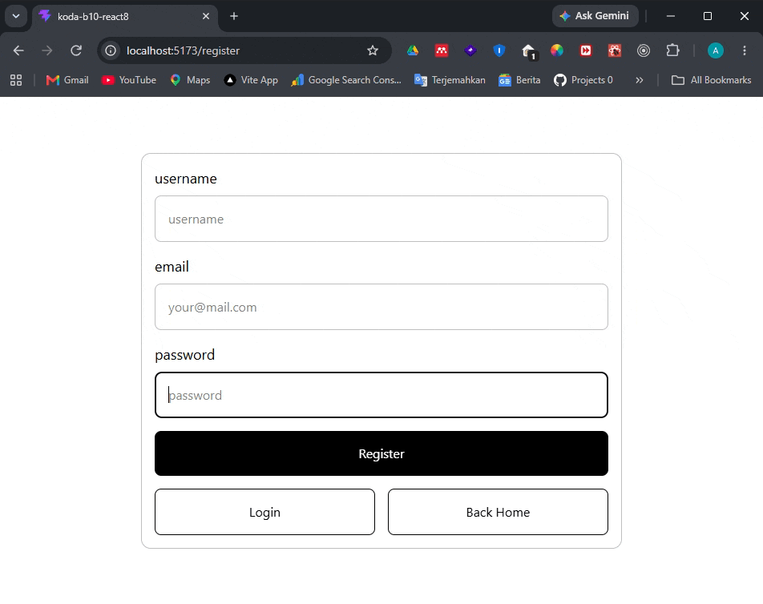

# React 8
on this repo i learn to use most advance global state concept, with react context and react reducer.
i also add a simple, validation and persistence data using local storage with custom hook

### result

